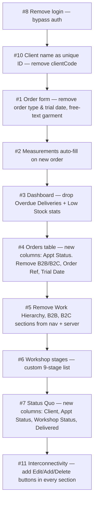

# Internal HB — Full Change Execution Plan

> [!NOTE]
> All changes are in `public/app.js`, `public/styles.css`, and `server/index.js`.  
> No new files needed. Changes are grouped by file and ordered safest-first.

---

## Change Map



---

## Change 1 · Order Form Simplification
**File:** `public/app.js` → `orderForm()`

**Remove:**
- `Order type` field (drop-down — doesn't exist yet but `legacyOrderForm` has appointment type)
- `Trial date` field (`trialDate`)

**Change:**
- `Garment` from plain text input (already free-text ✓) — confirm it's a plain `<input>`, not a `<select>`

**Keep:** Order date, Client selector, Garment (free text), Delivery date, Notes, Admin financial fields

**New order form layout (2-col grid):**
```
[Order date *]  [Client *]
[Garment / custom description — full width]
[Delivery date]  [Notes — full width]
[Admin: Total ₹]  [Admin: Advance ₹]
[Cancel]  [Create order →]
```

> [!IMPORTANT]
> `trialDate` feeds `appointment.date` in the backend. After removal, `appointment.date` will be blank for new orders — the Schedule page (which shows orders by appointment date) will show nothing until an appointment date is set via Edit. This is acceptable since the schedule's "New appointment" button opens `orderForm()` anyway — we'll redirect that to a dedicated appointment-date-only modal instead.

**New: Appointment Date modal** (separate from order form) — called from Schedule page's "New appointment" and each order's "Edit appointment" button. Fields: `Client` (read-only if pre-filled), `Appointment date`, `Appointment state`.

---

## Change 2 · Measurements Auto-fill on New Order
**File:** `public/app.js` → `orderForm()` post-submit flow

**Current behaviour:** After order created, `measurementsForm(client)` opens — you fill in measurements fresh.

**New behaviour:**
1. Fetch the client's saved measurements from `GET /api/clients/:name`
2. If measurements exist → show a **read-only preview panel** ("Using saved measurements — ✓ Chest 42 in, Waist 36 in…") with an "Edit measurements" link
3. If no measurements → open `measurementsForm(client)` as before

**Code location:** Inside `orderForm()` → `form.onsubmit` → after `node.remove()`:
```js
const { client } = await api(`/api/clients/${encodeURIComponent(body.clientName)}`);
const hasMeasurements = Object.values(client.measurements || {}).some(v => v);
if (hasMeasurements) {
  toast(`Using saved measurements for ${client.name}.`);
  navigate('workshop');
} else {
  measurementsForm(client, () => navigate('workshop'));
}
```

> [!TIP]
> No backend change needed — measurements are already stored per client and reused across orders automatically. The only change is **skipping the form** when measurements already exist.

---

## Change 3 · Dashboard — Remove "Overdue Deliveries" & "Low Stock Items" Stats
**File:** `public/app.js` → `renderDashboard()`

**Current 4 stat cards:** Active orders | Clients | Appointments | Needs attention  
**New 2 stat cards (keep only):** Active orders | Clients  
*(Drop "Appointments" and "Needs attention" / overdue / low stock variants)*

Also remove these from `GET /api/dashboard` response (or just stop displaying them — backend can stay as-is for now).

**CSS:** Change `.stat-grid` from `repeat(4, 1fr)` to `repeat(2, 1fr)` on the dashboard (or just render 2 cards — the grid auto-fills).

---

## Change 4 · Orders Table — Column Redesign
**File:** `public/app.js` → `orderTable()`

**Remove columns:** B2B/B2C, Order Ref, Trial Date  
**Add column:** Appointment Status

**New column order:**

| Client | Garment | Order Date | Appointment Status | Workshop Stage | (Actions) |
|---|---|---|---|---|---|

**Appointment Status badge logic (3 states):**
- 🔴 **Pending** — appointment date has already passed and state ≠ completed
- ✅ **Done** — appointment state = `completed`  
- 🔵 **Upcoming** — appointment date is in the future

```js
function apptStatusLabel(order) {
  const s = order.appointmentStatus; // already computed server-side
  if (s === 'completed') return ['done', 'Done'];
  if (s === 'pending') return ['pending', 'Pending'];
  if (s === 'scheduled' && order.appointment?.date) return ['scheduled', 'Upcoming'];
  return ['', '—'];
}
```

> [!NOTE]
> The server already computes `appointmentStatus` correctly (`completed`, `pending`, `scheduled`, `postponed`). We just rename `scheduled` → "Upcoming" in the display label only.

---

## Change 5 · Remove Work Hierarchy, B2B/B2C Sections
**File:** `public/app.js` → `navItems()`  
**File:** `server/index.js` — no routes to remove (these were SuitsK-only sections never ported)

**Action:** Confirm these nav items do NOT exist in `navItems()` already. They don't — current nav is:
`dashboard, clients, measurements, inventory, schedule, orders, workshop, status, care`

✅ Nothing to remove. These sections were never added to Internal HB. **No change needed.**

---

## Change 6 · Workshop Stages — Replace with Custom 9 Stages
**File:** `server/index.js` line 16

**Current:**
```js
const WORKSHOP_STAGES = ['Material', 'Cutting', 'Embroidery', 'Hand Work', 'Stitching', 'Fitting', 'Finishing', 'Presentation', 'Delivered'];
```

✅ **Already correct!** The stages were already updated in a prior change. Verify they match exactly:
`Material → Cutting → Embroidery → Hand Work → Stitching → Fitting → Finishing → Presentation → Delivered`

**Workshop board CSS:** Current grid is `repeat(3, 1fr)` — with 9 columns that wraps to 3 rows of 3. This is fine. Optionally change to a horizontal scrollable single row for Kanban feel:
```css
.workshop-grid { grid-template-columns: repeat(9, minmax(160px, 1fr)); overflow-x: auto; }
```

---

## Change 7 · Status Quo — New Column Layout
**File:** `public/app.js` → `renderStatus()` + `orderTable()` variant

**Current:** Reuses `orderTable()` with `actions = false`  
**New:** Dedicated status table with specific columns:

| Client Name | Appointment Status | Workshop Status | Delivered |
|---|---|---|---|
| clickable → profile | badge (Pending/Done/Upcoming/Postponed) | stage name | ✓ / — |

**Implementation:** Create a new `statusTable(orders)` function instead of reusing `orderTable()`:
```js
function statusTable(orders) {
  if (!orders?.length) return empty('No orders yet', '...');
  return `<div class="table-wrap"><table class="table">
    <thead><tr>
      <th>Client</th><th>Appointment status</th><th>Workshop status</th><th>Delivered</th>
    </tr></thead>
    <tbody>${orders.map(order => `<tr>
      <td><button class="text-button" data-client="${esc(order.clientName)}">${esc(order.clientName)}</button></td>
      <td><span class="badge ${esc(order.appointmentStatus)}">${apptDisplayLabel(order)}</span></td>
      <td><span class="stage-dot"></span>${esc(order.workshopStage)}</td>
      <td>${order.delivered ? '<span class="badge completed">Delivered</span>' : '—'}</td>
    </tr>`).join('')}</tbody>
  </table></div>`;
}
```

---

## Change 8 · Remove Login Page (Bypass Auth)
**Files:** `public/app.js` + `server/index.js`

**Frontend:** Change the bootstrap entry point to skip `renderLogin()` and go straight to `bootstrap()` with a fake user object:
```js
// Replace the last line:
// api('/api/auth/me').then(...).catch(() => renderLogin());
// With:
state.user = { id: 'local', username: 'HB', role: 'admin' };
bootstrap();
```

**Backend:** Remove `requireAuth` middleware from all routes, OR add a bypass middleware:
```js
// In server/index.js, after session middleware, add:
app.use((req, res, next) => {
  if (!req.session.user) {
    req.session.user = { id: 'local', username: 'HB', role: 'admin' };
  }
  next();
});
```

> [!WARNING]
> This removes all authentication. Only do this if the app runs locally or on a private network. If it's deployed publicly, re-enable auth before going live.

---

## Change 9 · (Was in earlier plan) — Already done
CSS `.profile-layout` double-dot typo — ✅ Fixed.

---

## Change 10 · Client Name as Unique Identity — Remove Client Code
**Files:** `public/app.js`, `server/index.js`

**Current:** Server already uses `nameKey` (lowercased name) as the unique key — no separate `clientCode` field exists in the data model. Client name IS already the unique identity.

✅ **Already the case in Internal HB.** The `nameKey` is derived from `name` and used as the lookup key for all API routes (`/api/clients/:name`). **No change needed.**

---

## Change 11 · Full Interconnectivity — Edit / Add / Delete in Every Section

This is the largest change. Here is each section and what needs to be added:

### Dashboard
- [x] Client name click in Recent Orders → `clientProfile()` ✅ (done)
- [ ] "New order" header button → opens `orderForm()` ✅ already there
- [ ] Each order row → "Edit" button → `orderForm('', id)` ✅ already there

### Client Profiles List
- [x] "Open profile" button → `clientProfile()` ✅
- [x] "Edit" button → `clientForm(name)` ✅
- [x] "Delete" button ✅
- [ ] ADD: From client card, quick "Add order" button that pre-fills client → `orderForm(client.name)`

### Client Profile (detail view)
- [x] "Add order" header button ✅
- [x] "Edit client" button ✅
- [x] "Edit measurements" button ✅
- [ ] ADD: Per-order "Edit appointment" button → appointment-date modal
- [ ] ADD: Per-order "Move stage" dropdown or button → advance workshop stage inline
- [ ] ADD: "Delete order" button in the orders panel within profile

### Measurements Page
- [x] Client name click → profile ✅
- [x] "Edit sheet" → `measurementsForm()` ✅ (now stays on page after save)
- [ ] ADD: After saving measurements, re-render measurements list ✅ (done via `onSave` callback)

### Orders Page
- [x] Client name click → profile ✅
- [x] Edit / Delete buttons ✅
- [ ] ADD: Filter by workshop stage (dropdown alongside active/delivered filter)
- [ ] ADD: "Edit appointment" button per row → appointment modal

### Workshop
- [x] Client name click → profile ✅
- [x] "Move forward" button ✅
- [ ] ADD: "Move back" button (to un-advance a stage)
- [ ] ADD: Clicking garment name → opens order edit form

### Schedule
- [x] Client name click → profile ✅
- [x] "Edit" per appointment → `orderForm()` ✅
- [ ] ADD: Mark appointment as "Done" button directly on the schedule card (sets state = completed)
- [ ] ADD: Mark as "Postponed" button

### Status Quo
- [x] Client name click → profile ✅ (after Change 7)
- [ ] ADD: Workshop stage click → opens workshop filtered to that stage
- [ ] ADD: "Edit" button per row → opens order form

### Care Support
- [ ] ADD: Pull real client care notes from API (clients with non-empty `careNotes`)
- [ ] ADD: Each entry links → `clientProfile()`

---

## Execution Order

| # | Change | Files | Backend? | Risk |
|---|---|---|---|---|
| 1 | Remove login (bypass auth) | `app.js`, `server/index.js` | ✅ | Low |
| 2 | Dashboard stat cards (remove 2) | `app.js` | ✗ | Low |
| 3 | Order form (remove trial date) | `app.js` | ✗ | Low |
| 4 | Measurements auto-fill logic | `app.js` | ✗ | Low |
| 5 | Appointment status display labels | `app.js` | ✗ | Low |
| 6 | Orders table new columns | `app.js` | ✗ | Medium |
| 7 | Status Quo new table | `app.js` | ✗ | Low |
| 8 | Workshop CSS (9-col horizontal) | `styles.css` | ✗ | Low |
| 9 | Interconnectivity additions per section | `app.js` | ✗ | Medium |
| 10 | Appointment-date modal (new) | `app.js` | ✗ | Medium |

> [!TIP]
> Say **"proceed"** and all changes will be applied to your files in one go.
